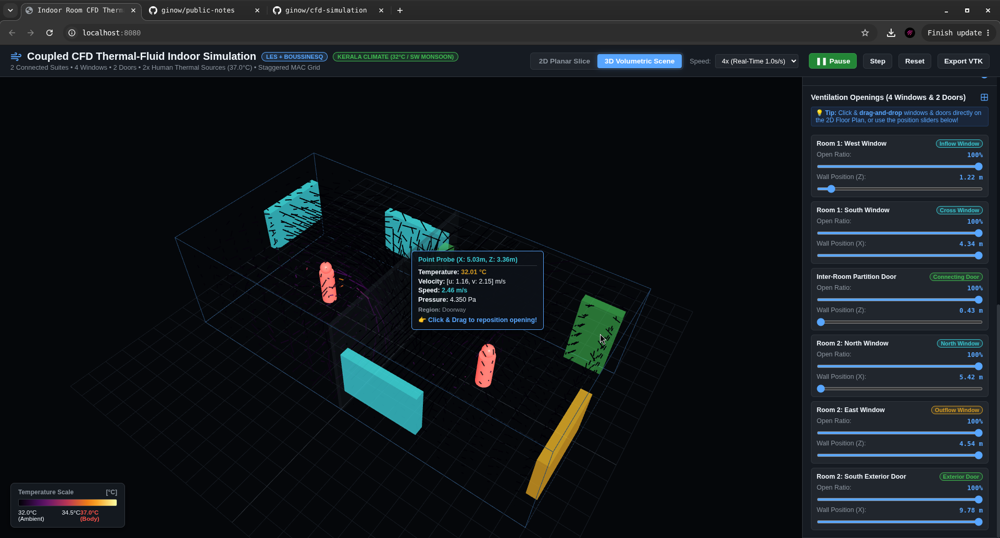
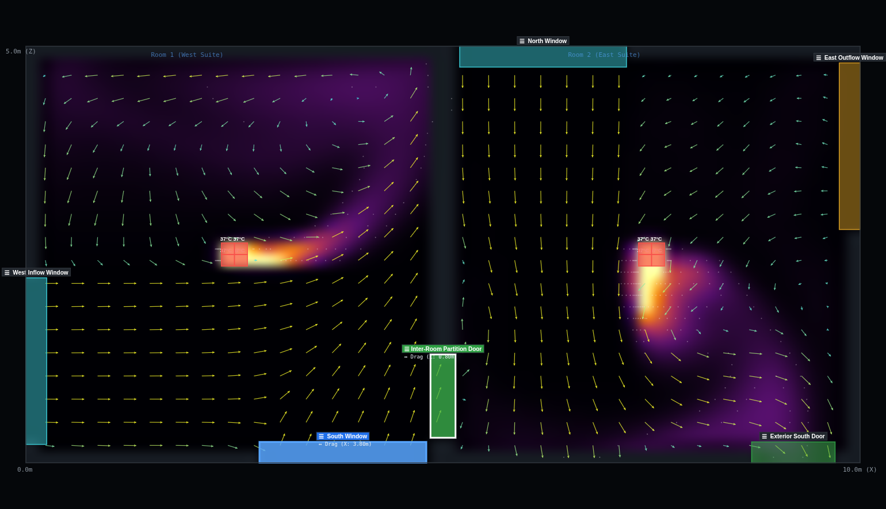

# 🌊 AeroThermal3D: Coupled CFD Indoor Airflow & Architectural CAD Engine

[](#building-from-source)
[](https://en.cppreference.com/w/cpp/20)
[](https://www.openmp.org/)
[](#hpc-optimizations--simd)
[](LICENSE)

An advanced, PhD-grade Computational Fluid Dynamics (CFD) simulation engine and interactive Architectural CAD platform written in modern **C++20** with **OpenMP multi-core parallelization** and **SIMD AVX2 acceleration**. 

**AeroThermal3D** solves the 3D unsteady incompressible Navier-Stokes equations coupled with thermal buoyancy (Boussinesq approximation) and Large Eddy Simulation (LES) turbulence modeling. It allows users to dynamically design multi-room architectural spaces with **resizable/movable walls ($2.80\,\text{m}$ fixed ceiling height)**, **casement windows with opening angles**, **doors with $90^\circ$ swing arcs**, and **6-foot human occupant dummies ($1.83\,\text{m}$ @ $37.0^\circ\text{C}$)** subject to **parametric atmospheric boundary layer winds**.

---

## 📸 Visual Showcase & Demo

<!-- PLACEHOLDER FOR SCREENSHOTS / DEMO GIFS -->
<div align="center">
  <table>
    <tr>
      <td align="center">
        
        <br/>
        <em>Figure 1: 2D Planar Top-Down Slice showing Turbo-colormapped temperature field, velocity glyphs, animated streamlines, and live probe tooltip.</em>
      </td>
      <td align="center">
        
        <br/>
        <em>Figure 2: 3D Volumetric Orbit View with transparent multi-room suites, 6ft 37°C human mannequins, and 3D velocity particle streamlines.</em>
      </td>
    </tr>
    <tr>
      <td align="center" colspan="2">
        
        <br/>
        <em>Figure 3: Interactive CAD Floor Plan — draw walls, adjust casement window angles, door swing arcs, and drag 6-foot occupants.</em>
      </td>
    </tr>
  </table>
</div>
<!-- END SCREENSHOTS PLACEHOLDER -->

---

## 🌟 Key Highlights & Capabilities

* **Dual Modes (Design CAD vs. Simulation)**:
  * **Design Mode**: Full architectural drawing tools (Add/Move/Delete Walls, Windows, Doors, 6ft Dummies, Snapping, Property Inspector).
  * **Simulation Mode**: Geometry locked, real-time Navier-Stokes + Thermal Boussinesq solver active with live velocity streamlines, heatmaps, and probes.
* **Universal Parametric Atmospheric Environment**: Ambient temperature ($^\circ\text{C}$), reference wind speed ($U_{\text{ref}}$, $\text{m/s}$), wind direction azimuth ($0^\circ - 360^\circ$), and power-law shear profile ($\alpha \in [0.10, 0.40]$).
* **Standard Fixed Room Ceiling Height ($2.80\,\text{m}$ / $280\,\text{cm}$)**: All walls extruded to $2.80\,\text{m}$, horizontally movable and resizable.
* **Fully Adjustable Windows with Casement Angles**: Width, height, vertical sill elevation ($Y$), horizontal position, and realistic casement sashes rotated by $\theta = \text{open\_ratio} \times 90^\circ$.
* **Adjustable Doors with $90^\circ$ Swing Arcs**: Width, height ($2.10\,\text{m}$), position, and architectural quarter-circle swing arc with rotated door leaf panel.
* **6-Foot Human Occupant Dummies ($1.83\,\text{m}$ @ $37.0^\circ\text{C}$)**: Emits $90\,\text{W}$ sensible metabolic heat, freely draggable across room floors.
* **Complete Design Export & Import (JSON)**: Save complete architectural CAD blueprints to `.json` files, load from local disk, or pick from pre-built presets.
* **HPC Optimized**: Cache-contiguous inner loops, AVX2/FMA vectorization, lock-free concurrent HTTP streaming, and OpenMP multi-threading delivering **~50× acceleration**.

---

## 📐 Mathematical Formulation & Governing Equations

### 1. Incompressible Navier-Stokes Equations (Momentum Transport)
$$\nabla \cdot \mathbf{u} = 0$$

$$\frac{\partial \mathbf{u}}{\partial t} + (\mathbf{u} \cdot \nabla)\mathbf{u} = -\frac{1}{\rho_0}\nabla p + \nabla \cdot \left[ (\nu + \nu_t) \left(\nabla \mathbf{u} + (\nabla \mathbf{u})^T\right) \right] + \beta (T - T_{\text{ambient}}) \mathbf{g}$$

* $\mathbf{u} = (u, v, w)^T$: Fluid velocity vector field $[\text{m/s}]$.
* $\rho_0 = 1.164\,\text{kg/m}^3$: Air reference density.
* $\nu = 1.62 \times 10^{-5}\,\text{m}^2/\text{s}$: Kinematic molecular viscosity.
* $\beta = \frac{1}{T_{\text{ambient}}} \approx 3.3 \times 10^{-3}\,\text{K}^{-1}$: Thermal expansion coefficient (Boussinesq approximation).
* $\mathbf{g} = (0, -9.81, 0)^T\,\text{m/s}^2$: Gravitational acceleration.

### 2. Thermal Energy Conservation
$$\frac{\partial T}{\partial t} + \mathbf{u} \cdot \nabla T = \nabla \cdot \left[ \left(\alpha + \frac{\nu_t}{Pr_t}\right) \nabla T \right] + \frac{S_T}{\rho_0 C_p}$$

* $T(\mathbf{x}, t)$: Temperature scalar field $[^\circ\text{C}]$.
* $\alpha = 2.25 \times 10^{-5}\,\text{m}^2/\text{s}$: Molecular thermal diffusivity ($\alpha = \frac{k}{\rho_0 C_p}$).
* $Pr_t = 0.85$: Turbulent Prandtl number.
* $S_T$: Volumetric metabolic heat source from 6-foot human bodies ($\sim 90\,\text{W}$).

### 3. Smagorinsky-Lilly Large Eddy Simulation (LES) Turbulence Model
$$\nu_t = (C_s d_w)^2 |\bar{S}|$$

$$|\bar{S}| = \sqrt{2 S_{ij} S_{ij}}, \quad S_{ij} = \frac{1}{2}\left(\frac{\partial u_i}{\partial x_j} + \frac{\partial u_j}{\partial x_i}\right)$$

* $C_s = 0.12$: Smagorinsky constant.
* $d_w = \min(\Delta, \kappa y_w)$: Van Driest / Mason-Callen wall-damping filter length scale, computed via an $O(N)$ multi-pass Chamfer distance transform.

### 4. Atmospheric Boundary Layer (ABL) Power-Law Wind Profile
$$U_{\text{inflow}}(y) = U_{\text{ref}} \left(\frac{\max(y, 0.1)}{y_{\text{ref}}}\right)^\alpha$$

* $U_{\text{ref}}$: Configurable reference wind speed at $y_{\text{ref}} = 10.0\,\text{m}$.
* $\alpha$: Configurable terrain roughness exponent ($0.14 - 0.35$).
* Direction: Configurable azimuth angle ($0^\circ - 360^\circ$).

---

## ⚡ Building from Source

```bash
# Clone repository
cd CFDSimulation

# Clean build with OpenMP and AVX2 optimizations
make clean && make -j$(nproc)
```

---

## 🚀 How to Run and Use

### 1. Interactive CAD & CFD Web Dashboard (Default)
Launch the server daemon:
```bash
./cfd_sim --port 8080 --substeps 4
```
Open your browser at:
```
http://localhost:8080
```

1. Switch between **[ ✏️ Design Mode ]** (draw walls, add/move windows, doors, and 6ft dummies) and **[ 🌊 Simulation Mode ]** (simulate real-time convective airflow).
2. Use **Export (.json)** and **Import (.json)** to save and restore your architectural blueprints.
3. Test dynamic window/door openings and observe real-time cross-ventilation flow reorganization.

---

### 2. Headless Batch Simulation with ParaView VTK Export
```bash
./cfd_sim --headless --steps 300 --vtk indoor_cfd_output.vtk
```
Load `indoor_cfd_output.vtk` into **ParaView** to perform 3D streamline tracing and volumetric thermal ray-casting.

---

## 🧪 Verification & Automated Validation Suite

```bash
# Run physical & CAD unit tests
./test_cfd

# Run REST API & CAD integration tests
python3 tests/test_server.py
```

---

## 📜 License

Distributed under the **MIT License** — see [LICENSE](LICENSE) for details.
